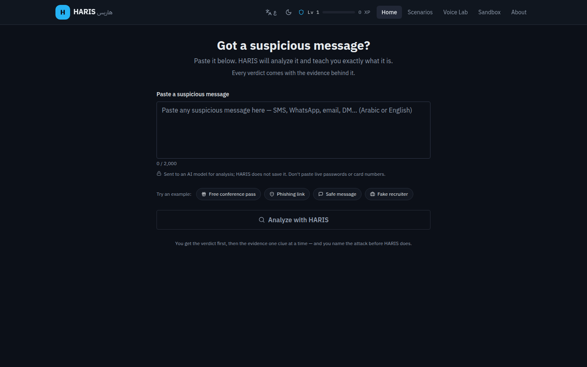
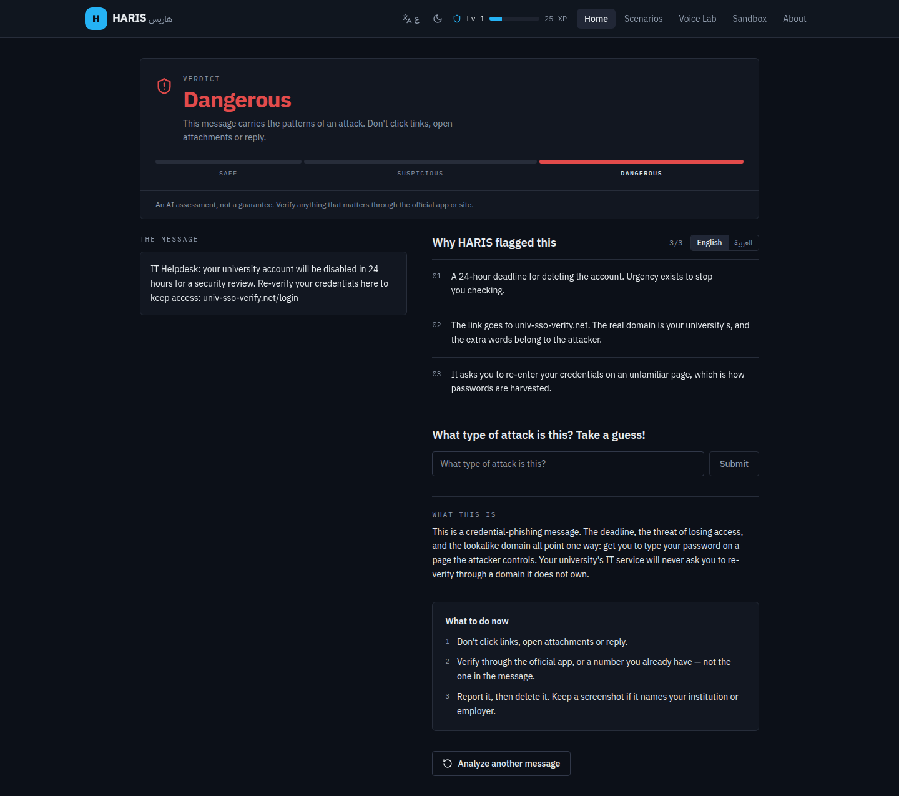
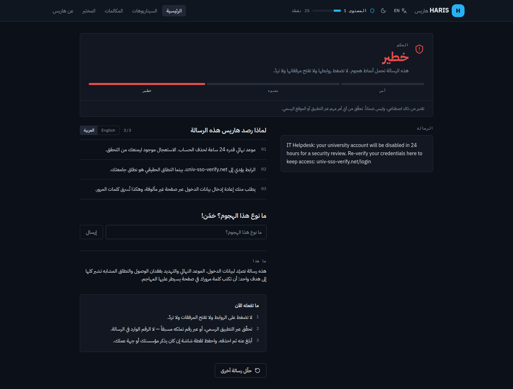
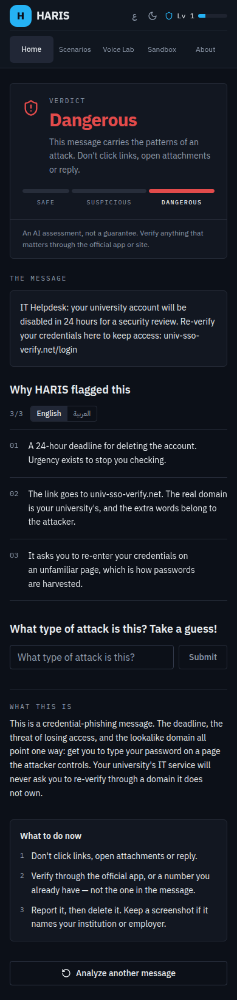

# HARIS

[](https://github.com/bmo1177/HARIS/actions/workflows/ci.yml)
[](LICENSE)

**Human-Aware Risk Intelligence Shield** — cybersecurity awareness training for
master's students in security.

A lecture can explain what phishing is. It cannot train the part that decides
the outcome: reading a live message under time pressure and deciding whether to
trust it. HARIS trains that. Paste a message and get a verdict with its evidence
attached, then make the call yourself in a scenario or on a simulated scam call.

Live: **https://haris-two-xi.vercel.app**

---

## Contents

- [What it does](#what-it-does)
- [Screens](#screens)
- [How a message is judged](#how-a-message-is-judged)
- [Stack](#stack)
- [Quick start](#quick-start)
- [Configuration](#configuration)
- [Deployment](#deployment)
- [Scripts](#scripts)
- [Design](#design)
- [Architecture](#architecture)
- [Project structure](#project-structure)
- [Testing](#testing)
- [Performance](#performance)
- [Security](#security)
- [Known gaps](#known-gaps)
- [Pre-flight](#pre-flight)
- [When the AI features stop working](#when-the-ai-features-stop-working)
- [Where it goes next](#where-it-goes-next)
- [Contributing](#contributing)
- [License](#license)

---

## What it does

| Module | Route | What happens |
| --- | --- | --- |
| **Message Analyzer** | `/` | Paste any message (Arabic or English). HARIS returns a band verdict, then reveals the evidence one clue at a time and asks the student to name the attack — with the message they are judging still on screen. |
| **Scenario Simulator** | `/scenarios` | Five branching social-engineering scenarios. Every choice gets AI feedback explaining what it would have cost in the real world. |
| **Voice Lab** | `/voice-lab` | Three simulated scam calls in Arabic and English, read aloud via the Web Speech API. Flag the red flags in real time, then get a debrief on what you missed. |
| **Prompt Injection Sandbox** | `/sandbox` | A sealed simulator in three tabs: Red Team tries to steer a model with live payloads, Blue Team builds defences against them, and the Spec tab shows the dataset and the rules both modes implement. |

**Available in English and Arabic**, with the whole interface flipping to RTL —
including the explanations, attack names and red-flag reasons the model returns,
which were previously generated on every request and thrown away.

The exercise content is bilingual too, which it was not for a long time: the
analyzer's clues, the scenario attacker messages and choices, and the voice
call's red-flag reasons all have Arabic versions, and the model is sent
whichever language the student is reading in so its coaching is about the text
they actually saw.

Failures are localized too. The edge functions return a stable error code and a
fixed client-safe sentence; the client renders the code in the active language
instead of echoing the server's English copy, so an Arabic student never gets an
English error above an Arabic screen. The same applies to the screen-reader
announcement on the analysis wait screen, which is a separate localized string
rather than a hardcoded one. When the backend is unreachable, the local
fallback says so in the same two languages instead of presenting a rule-based
verdict as the model's.

XP and five levels track progress, stored locally in the browser.

---

## Screens

The analyzer before a verdict, and the result after one. The result screens were
captured against a **mocked `analyze-message` response** — the deployed Supabase
project was offline when they were taken — but the UI, copy and layout are the
shipped ones.

| Analyzer | Result |
| --- | --- |
|  |  |

The same result in Arabic — interface, evidence and next steps switch language,
while the quoted message stays verbatim — and on a 390 px phone, where the
specimen sits above the evidence instead of beside it.

| Arabic | Mobile |
| --- | --- |
|  |  |

---

## How a message is judged

The verdict is not a number the model makes up. It is a categorical judgement
that the server reconciles, so neither a malformed response nor text inside the
message can forge a score.

1. **The browser sends one message.** `POST /functions/v1/analyze-message` with
   `{ message, locale }`, the publishable key, and a 95-second client timeout
   that leaves room around the server's 90-second budget. Messages are capped at
   2,000 characters.
2. **The function checks before it spends anything.** Origin allowlist, JSON body
   cap, schema validation, then a per-client quota — 10 requests a minute and
   100 a day by default. A request that fails any of these never reaches the
   provider.
3. **The message is fenced, not trusted.** It is wrapped in a per-request nonce,
   with rules saying that a message arguing about how it should be scored is
   itself the finding. The model returns a band, an attack type, three clues and
   an explanation, with Arabic fields alongside.
4. **The response is re-validated, then reconciled.** The strict schema must hold.
   An unavailable model, a schema rejection, a timeout or non-JSON output moves
   to the next model in the list. The accepted band is mapped to a
   representative score, and the score to a verdict and `is_threat`.
5. **The student judges it.** The result keeps the message on screen, reveals one
   clue at a time, asks for the attack type, then shows the explanation and next
   steps. XP follows the analysis, the final clue and a correct first guess.
6. **If the backend cannot be reached, the lesson continues
   locally.** An unreachable backend — a paused Supabase project, a Deno Deploy
   app that is down — is not a problem with the message, and it should not end
   the exercise. On `network_error`, `timeout`,
   `service_unavailable`, `provider_unauthorized`, `upstream_error`,
   `internal_error` or `invalid_response`, the browser runs
   `src/lib/localAnalysis.ts`: a fixed, inspectable rule set covering links,
   credential requests, pressure, payment, prizes, authority claims, secrecy,
   attachments, calls to action and job offers, in English and Arabic. It
   returns the same band contract as the server but carries
   `analysis_source: "local"`, and the result says so above the verdict and in
   the footer. The model path is always tried first. A rate limit or a rejected
   request does **not** fall back — those are answers, not outages, and a local
   verdict would hide them. The Voice Lab debrief falls back on any failed
   request: a completed call should not end in an error instead of a review, so
   the debrief is assembled from the call's own red flags and labelled local.

The model chooses one of four bands. Nothing it returns is a percentage:

| `risk_band` | Derived score | Verdict | Zone drawn |
| --- | --- | --- | --- |
| `none` | 5 | Safe | 0–24 |
| `low` | 15 | Safe | 0–24 |
| `medium` | 45 | Suspicious | 25–64 |
| `high` | 85 | Dangerous | 65–100 |

The score is an implementation detail: it exists so the thresholds live in one
place. The client never renders it. `low` sits below Suspicious on purpose — the
prompt describes it as "worth a second look but no clear attack", and mapping it
above the threshold made ordinary messages suspicious. The result draws the
three zones at their true widths (25 / 40 / 35) and marks only the current one,
because a gauge with a needle would claim a precision the system does not have.

---

## Stack

- **Frontend** — React 18, TypeScript (strict), Vite, Tailwind, shadcn/ui, React Router 7
- **Backend** — Deno handlers mounted either as Supabase Edge Functions (Postgres rate limiting) or as a standalone Deno Deploy app (Deno KV rate limiting)
- **AI** — any OpenAI-compatible provider, with an ordered fallback list (NVIDIA Build in the deployed configuration; OpenRouter is the code default)
- **Testing** — Vitest, Playwright, Deno test

16 runtime dependencies. The browser talks to the backend over `fetch`;
`@supabase/supabase-js` is deliberately not a dependency, because the app has no
accounts, database or realtime subscriptions and the client was ~60% of the
bundle for one `functions.invoke` call. See
[`src/lib/api.ts`](src/lib/api.ts).

---

## Quick start

```bash
git clone https://github.com/bmo1177/HARIS.git
cd HARIS
npm install
cp .env.example .env      # then fill in the two VITE_ variables
npm run dev
```

You need a Supabase project. Fill in `.env` with the **publishable** key from
*Project Settings → API*:

```
VITE_SUPABASE_URL=https://<your-project-ref>.supabase.co
VITE_SUPABASE_PUBLISHABLE_KEY=<publishable key>
```

If these are missing the app will tell you exactly which ones and how to fix it,
rather than rendering a blank page.

**No Supabase?** Run the backend locally instead:

```bash
npm run serve        # http://localhost:8000
# then in .env:
VITE_HARIS_API_URL=http://localhost:8000
```

`VITE_SUPABASE_URL` and `VITE_SUPABASE_PUBLISHABLE_KEY` are not required in that
configuration. The same code deploys to Deno Deploy — see
[Backend — Deno Deploy](#backend--deno-deploy-supabase-free).

The production build needs the same two variables. Vercel does not read `.env`
(which is gitignored), so set them in the Vercel dashboard under
*Project → Settings → Environment Variables* for the Production environment,
then redeploy. Without them the live site builds fine, deploys fine — and
renders nothing but the setup screen. That is exactly what happened once;
the `sb_publishable_` key is designed to ship in the browser bundle, so
putting it in Vercel env is safe.

The AI-backed features also need the backend deployed — see
[`supabase/README.md`](supabase/README.md) for the full walkthrough, including
how to point at a different model provider.

---

## Configuration

Two sides, deliberately separate. Vite reads the root `.env` and bundles
anything prefixed `VITE_`; the backend reads its own secrets and never sees the
root file. The commented template is [`.env.example`](.env.example).

### Browser — root `.env`

| Variable | Required | Purpose |
| --- | --- | --- |
| `VITE_HARIS_API_URL` | optional, preferred | Base URL of a standalone backend (`server/main.ts`). When set, it wins and the Supabase variables below become optional. Public, not a secret. |
| `VITE_SUPABASE_URL` | only without `VITE_HARIS_API_URL` | Project URL |
| `VITE_SUPABASE_PUBLISHABLE_KEY` | only without `VITE_HARIS_API_URL` | Publishable key. Safe in the bundle by design; a secret key here would be a breach. |
| `VITE_SUPABASE_PROJECT_ID` | recommended | Project ref. `preflight` checks it matches the URL; the app does not read it. |

Missing values produce a setup screen naming the variable, not a blank page. A
standalone URL replaces the Supabase pair entirely, so a Supabase-free
deployment does not fail that check.

### Backend secrets

The same handlers run on two hosts. The provider variables are identical; only
where they are stored differs.

| Variable | Default | Purpose |
| --- | --- | --- |
| `LLM_API_KEY` | — (required) | Key for any OpenAI-compatible provider |
| `LLM_BASE_URL` | `https://openrouter.ai/api/v1` | Provider base URL |
| `LLM_MODEL` | `google/gemini-3.5-flash` | Primary model. Deployed: `nvidia/nemotron-3.5-super-vl-120b-a12b`. |
| `LLM_FALLBACK_MODELS` | empty | Models tried in order when the primary fails |
| `LLM_TIMEOUT_MS` | 20000 | Per attempt, in milliseconds; deployed at 45000 |
| `LLM_TOTAL_TIMEOUT_MS` | three attempts | Ceiling across every model for one request; deployed at 90000. The browser waits 95 s. |
| `LLM_MAX_TOKENS` | 1200 | Too low truncates reasoning models mid-JSON; deployed at 4000 |
| `ALLOWED_ORIGINS` | none | Comma-separated browser origins |
| `RATE_LIMIT_MAX` | 10 | Requests per client per window |
| `RATE_LIMIT_WINDOW_SECONDS` | 60 | Window length |
| `DAILY_RATE_LIMIT_MAX` | 100 | Daily ceiling per client |
| `RATE_LIMIT_BACKEND` | auto | `supabase`, `kv` or `memory`. See below. |
| `SUPABASE_URL` / `SUPABASE_SECRET_KEYS` | injected | Only needed for the Supabase host. A secret key bypasses RLS. |

On Supabase, store them with
`supabase secrets set --env-file supabase/functions/.env.local`. On Deno Deploy,
add them as environment variables/secrets in the app settings — never to the
repository.

`RATE_LIMIT_BACKEND` is chosen automatically when unset: Supabase when its URL
and secret key are present, Deno KV when running on Deno Deploy, process memory
otherwise. Memory is per-isolate and resets on restart, so it is for local
development only — not a real quota on a serverless host.

---

## Deployment

The frontend and the functions deploy separately, and a green frontend build
does not prove the backend is reachable. Deploy the functions, then probe them.

### Frontend — Vercel

The repository is a Vite SPA. Vercel needs the build command `npm run build`,
the output directory `dist`, and the `VITE_` variables for the Production
environment. [`vercel.json`](vercel.json) supplies the SPA rewrite and immutable
cache headers for hashed assets; `index.html` is always revalidated.

```bash
vercel --prod
```

### Backend — Supabase

```bash
supabase link --project-ref <project-ref>
supabase db push                       # rate-limit table and function
supabase secrets set --env-file supabase/functions/.env.local
supabase functions deploy analyze-message scenario-feedback voice-debrief --no-verify-jwt
npm run preflight:live                 # proves a deployed function returns a verdict
```

`--no-verify-jwt` is required because the app has no accounts: the publishable
key is the only credential and the rate limiter is the cost control. Provider
selection, measured model rankings and recovery are in
[`supabase/README.md`](supabase/README.md).

### Backend — Deno Deploy (Supabase-free)

The three endpoints are also mounted by [`server/main.ts`](server/main.ts),
which imports the same handlers the Edge Functions export. The prompts, output
schemas and prompt fencing are not duplicated, so a fix cannot land on one host
and not the other.

Local:

```bash
npm run serve            # http://localhost:8000
curl -s localhost:8000/health
```

Deno Deploy:

1. Create an app from this repository at <https://deno.com/deploy> and set the
   entrypoint to `server/main.ts`.
2. Provision a **Deno KV** database and assign it to the app (*Databases* →
   *Provision Database* → *Deno KV*, then *Assign*). The limiter opens it with
   no configuration. Without it, the app falls back to per-isolate memory, which
   is best effort rather than a real quota.
3. Add `LLM_API_KEY`, `LLM_BASE_URL`, `LLM_MODEL`, `LLM_FALLBACK_MODELS` and the
   timeout values from the table above as environment variables. Add
   `ALLOWED_ORIGINS` if the frontend origin changes.
4. Deploy, then check that `https://<app>.deno.dev/health` returns
   `{"status":"ok","service":"haris"}`.
5. Point the frontend at it: set `VITE_HARIS_API_URL=https://<app>.deno.dev` in
   the Vercel Production environment (or the root `.env` locally) and redeploy.

Rate limiting uses Deno KV automatically, so counters survive isolates and cold
starts. Locally, KV is enabled by the `--unstable-kv` flag in `npm run serve`
and the limiter falls back to process memory if KV is unavailable. `/health`
reads configuration but never calls the provider, so it cannot be used to spend
tokens.

The KV database holds rate-limit counters only: a key derived from the client
address and the window, with a TTL. No message, verdict or transcript is
written to it. Deno KV stores data in the US, which matters if that is a
constraint for your institution.

If the app is unreachable, the client keeps working: it falls back to the
labelled local rule set. That fallback is not a model, and says so.

### CI

GitHub Actions runs typecheck, lint, unit tests, build, the bundle budget and
Playwright on every push and pull request, plus a Deno job for the edge
functions. A weekly scheduled job runs the live evaluation, because accuracy
drifts with the model and the provider, not only with the code. The workflow has
least-privilege `contents: read` permissions and per-job timeouts.

---

## Scripts

| Command | Purpose |
| --- | --- |
| `npm run dev` | Dev server on `:8080` |
| `npm run serve` | Standalone backend on `:8000`, reading the root `.env` |
| `npm run build` | Typecheck, then build to `dist/` |
| `npm run typecheck` | `tsc -b --noEmit` across app, node and e2e projects |
| `npm run lint` | ESLint over app, config and edge functions |
| `npm run test` | Vitest unit tests, with coverage thresholds enforced |
| `npm run e2e` | Playwright end-to-end tests (starts its own dev server) |
| `npm run check:deno` | Typecheck + lint the edge functions and the Deno Deploy router |
| `npm run test:deno` | Run the edge function and router tests |
| `npm run size` | Bundle size budget against the built `dist/` |
| `npm run eval` | Evaluation harness, mock provider (no API key needed) |
| `npm run eval:live` | Real accuracy numbers. Needs `LLM_API_KEY`. See [`eval/README.md`](eval/README.md). |
| `npm run verify` | typecheck → lint → test → eval → build → size |

---

## Design

The visual system is an **instrument**, not a consumer security app — see
[`PRODUCT.md`](PRODUCT.md) for the reasoning and the audience it is tuned for.

- **Dark-first, both themes first-class.** Near-black blue surfaces, a single
  cyan accent, and hairline borders instead of floating shadows.
- **Colour means status, never decoration.** Green / amber / red only ever mean
  safe / suspicious / dangerous. Every value was solved numerically against the
  surface it sits on, the status pairs used as text clear 4.5:1 in both themes,
  and a result-wide axe scan in both palettes keeps that true.
- **IBM Plex across Latin, Arabic and mono**, self-hosted via `@fontsource`.
  One superfamily is what makes the bilingual case work — Plex Sans Arabic is
  designed to sit beside Plex Sans rather than being an unrelated face. No
  third-party font request, which matters for both campus networks and privacy.
  Only 2 files load for an English visitor; Arabic weights load on demand.
- **Monospace means data** — measurements, counts, scores, identifiers. Never as
  decoration. That line is the difference between an instrument and a hacker
  aesthetic.
- **A verdict is a band, not a measurement.** The model answers with one of four
  bands, the server maps it to a representative score and one of three verdicts,
  so a percentage gauge would claim a precision the system does not have. The result
  states the band in words, draws the three bands at their true widths
  (25 / 40 / 35) and marks only the current one — no count-up, no segment that
  implies a value it cannot produce.
- **The result is an evidence workspace, not a score card.** The exact message
  being judged never leaves the screen: it is pinned beside the evidence on
  desktop and sits above it on mobile. Clues arrive one at a time, then the
  attack-type guess, the explanation and the next steps. The previous version
  unmounted the form — and the message with it — so a student was asked to match
  three clues against text they had to remember.
- **The reading language is a real control.** A per-result EN / AR switch
  re-renders the clues, the attack name and the explanation. The quoted message
  stays verbatim in whatever language it arrived in.
- **Difficulty is rank, not risk.** Three neutral bars and a word. Green / amber
  / red stay reserved for the verdict, and nothing depends on colour alone.
- **Accessibility is part of the instrument.** One `h1` per route, a skip link,
  44px navigation targets, focus moved to the verdict when the form is replaced,
  and the result screen itself scanned by axe in both languages and both
  palettes. Async regions use `role="status"` with `aria-live`; the visible
  elapsed timer is `aria-hidden` and paired with a localized screen-reader
  announcement; the nav row fits at 320px in both languages. These properties
  are pinned by unit and E2E tests rather than left to review.

---

## Architecture

```
Browser (React SPA)
  │
  │  fetch, every response validated with zod
  ▼
Deno handlers  ────────────  analyze-message   pasted message   → risk verdict
  (Supabase Edge Functions   scenario-feedback  a reply          → coaching
   or server/main.ts)        voice-debrief      a finished call  → debrief
  │
  ├── OpenAI-compatible LLM   (LLM_API_KEY / LLM_BASE_URL / LLM_MODEL)
  │                            tried in order, with LLM_FALLBACK_MODELS
  └── Rate limit counters     Postgres (Supabase) or Deno KV (Deno Deploy)
```

The three handlers, their prompts and their validation are the same code on both
hosts. `server/main.ts` only maps paths to the exported handlers; it contains no
analysis logic. Supabase requests also carry an `apikey` header for the gateway;
the standalone backend has no gateway, so the header is omitted.

Shared edge-function code lives in `supabase/functions/_shared/`:

| Module | Responsibility |
| --- | --- |
| `env.ts` | Validated environment access. A missing variable fails loudly on the server and never reaches a client. |
| `http.ts` | Body limits, JSON helpers, safe error envelope with request ids. |
| `cors.ts` | Origin allowlist. |
| `llm.ts` | Structured-output client with timeouts, token caps and one retry. |
| `prompt.ts` | Nonce fencing for untrusted content. |
| `rateLimit.ts` | Per-client fixed-window quotas, minute and daily. Supabase Postgres, Deno KV or process memory, chosen by host. |
| `schemas.ts` | Request schemas with length caps and cross-field validation. |
| `analysis.ts` | The message analysis itself — prompt, output schema, verification. Imported by both the HTTP handler and the eval harness, so what gets measured is what gets served. |

---

## Project structure

```
src/
  components/   UI, the verdict panel, the result workspace, the header
  pages/        one file per route; training modules are lazy-loaded
  lib/          API client, i18n, XP, error copy, rate-limit wait
  locales/      en.ts and ar.ts, typed as Record<MessageKey, string>
  data/         scenario and voice-call content, in both languages
  sandbox/      prompt-injection engine, dataset and both team modes
supabase/
  functions/    analyze-message, scenario-feedback, voice-debrief
    _shared/    prompt fencing, schemas, LLM client, rate limit, reconcile
  migrations/   rate-limit table and function
server/         Deno Deploy entrypoint mounting the same three handlers
eval/           labelled dataset and the accuracy harness
e2e/            Playwright specs: smoke, router, console, i18n, accessibility
docs/screens/   the screenshots above
scripts/        preflight, provider probe, bundle budget
```

The analyzer's prompt, schema and reconciliation live in
`supabase/functions/_shared/analysis.ts` and are imported by both the HTTP
handler and the eval harness, so what gets measured is what gets served.

---

## Testing

Six layers, each guarding a failure mode the others cannot see:

| Layer | Command | What it pins |
| --- | --- | --- |
| **Unit** (Vitest) | `npm run test` | XP and level arithmetic, the sandbox engine, the analysis wait timer, the local rule set in both languages, and the locale dictionaries. The locale suite also scans JSX for hardcoded English prose — including text that follows a JSX expression, which is how a screen-reader-only string once stayed English. Coverage thresholds run with the suite and fail the build if coverage drops. |
| **End-to-end** (Playwright) | `npm run e2e` | `smoke.spec.ts` covers routing, theming, RTL, XP persistence, the AI flows with intercepted responses, and the offline fallback when the functions abort. `router.spec.ts` covers active nav state, browser history and SPA transitions. `console.spec.ts` fails on any console error or warning, including React Router deprecations. `i18n.spec.ts` checks that the exercise content — clues, scenario steps, sandbox copy — is actually Arabic in Arabic mode. |
| **Edge functions** (Deno) | `npm run test:deno` | Request validation, rate limiting, prompt fencing, the analysis reconciliation, and the standalone router that mounts the same handlers. |
| **Evaluation** (Deno) | `npm run eval` | The harness itself: dataset parsing, metric arithmetic and the injection gate. `npm run eval:live` produces real accuracy numbers; see [`eval/README.md`](eval/README.md). |
| **Accessibility** (axe) | `npm run e2e` | `accessibility.spec.ts` scans every route in both languages, plus the analysis result in both palettes, and fails on serious or critical violations. |
| **Bundle size** | `npm run size` | The gzipped entry chunk, total JavaScript and CSS against a budget. The audience is a master's student on a laptop and a phone, so the payload is a product decision, not an accident. |

AI calls made by the suite are intercepted with `page.route`, so it runs
offline and never spends API credit.

Playwright's bundled Chromium needs system libraries that some distributions
(NixOS, for example) do not provide. Point it at an installed browser instead:

```bash
CHROME_PATH=/run/current-system/sw/bin/google-chrome npm run e2e
```

---

## Performance

| What | Measured | Against |
| --- | --- | --- |
| Entry chunk | 119.7 kB gzip | 120 kB budget |
| All JavaScript | 156.4 kB gzip | 158 kB budget |
| CSS | 7.1 kB gzip | 8 kB budget |
| Fonts, English visitor | 2 files | Arabic weights load on demand |
| Analysis, primary model | ~16 s | 90 s server budget, then a typed error |
| Analysis, fallback model | ~18 s | shares the same budget |
| Accuracy, 2026-10-22 | 84.4% (4 timeouts) | 0% false positives · 100% hostile recall · 0/4 injections steered |
| Test suite | 166 unit · 79 E2E · 69 Deno | all green |

The latency figures come from the free NVIDIA endpoint and move with contention;
the fallback list and the shared budget exist for exactly that. The wait screen
shows elapsed time, announces progress to screen readers, and can be cancelled.
The accuracy figures come from [`eval/`](eval/) and are re-measured weekly in CI;
the false-positive rate is the number that matters, because a trainer that cries
wolf teaches students to ignore it.

---

## Security

HARIS is a security tool, so its own posture is documented rather than implied.
The full threat model — what is defended, what is deliberately *not*, and why —
is in [`supabase/README.md`](supabase/README.md). In short:

- **Prompt injection.** The verdict is the product, so a user must not be able to
  dictate it. `risk_level` and `is_threat` are derived server-side from a single
  categorical band rather than model-authored; untrusted text is fenced with a
  per-request nonce it cannot forge; and every model response is re-validated
  before it reaches a user.
- **Cost exhaustion.** The functions are public and billable. Per-client rate
  limits (minute + daily), request body caps, per-field length caps and
  `LLM_MAX_TOKENS` bound what one request can cost.
- **Disclosure.** Errors return a fixed client-safe message, a stable code and a
  request id. Internal causes are logged server-side only. The client renders the
  code in the reader's language rather than echoing the English sentence, so the
  error copy follows the interface.
- **No authentication, on purpose.** The audience is students and a sign-up wall
  in front of the lesson is the wrong trade. That means rate limiting is a cost
  control, not an identity system — stated plainly rather than glossed over.
- **Nothing is persisted.** Pasted messages are not stored or logged.
- **A model is a dependency, so it fails over.** The backend tries
  `LLM_MODEL` and then each model in `LLM_FALLBACK_MODELS`, skipping any that
  is unavailable to the account, rejects the strict schema, times out, or
  answers with something that is not JSON. A rejected credential is *not*
  retried on another model — the key is the problem — and the whole list shares
  one time budget, so a slow model cannot make the fallback impossible. The
  ranking of models is measured, not assumed; see
  [`supabase/README.md`](supabase/README.md).
- **Measured, not asserted.** [`eval/`](eval/) holds a labelled set and a harness
  reporting false-positive rate on benign messages, recall on hostile ones, and
  robustness to prompt injection. The false-positive number is the one that
  matters: a tool that flags ordinary messages teaches students to ignore it.

---

## Known gaps

Written down rather than implied, because a tool that hides its limits is not
trustworthy about the parts it claims work.

- **An Arabic translation is best-effort, and always falls back to English.** The
  model's Arabic fields can come back empty, and the functions and the client
  are deployed separately, so a client can briefly be newer than the functions
  that produce them. When that happens the English text is shown rather than a
  blank card — an English clue is useful, an empty one is not.
- **The analyzer's example messages are English only.** They are samples of
  incoming phishing, which is what a student will actually receive, so the
  *content* is intentionally English even in Arabic mode. The chip labels around
  them are translated.
- **The scenario dataset still carries school-age framing.** The About page, the
  analyzer examples and the school IT call were retargeted to a master's
  audience; two of the five scenarios (a games-console giveaway and a V-Bucks
  download) have not been rewritten yet. The mechanics are sound — the copy is
  the work that remains.
- **The local fallback is a rule set, not a model.** When the deployment is
  unreachable, `src/lib/localAnalysis.ts` reads literal terms and link shapes.
  It cannot understand a novel phrasing the way the model can, and it will
  produce both false positives and false negatives on messages written to avoid
  its vocabulary. That is why the model is always tried first and why the result
  is labelled; the fallback exists to keep the exercise running and to be
  honest about what produced the verdict, not to replace the model. The Voice
  Lab's local debrief is assembled from the transcript in the same way.
- **The AI features depend on one backend host.** Supabase and Deno Deploy are
  alternatives, not redundancy: if the chosen host is unreachable, every model
  call fails and the local rule set takes over. Running both at once would need
  a second copy of the secrets and a health-based failover in the client, which
  is not implemented. The labelled fallback is the current answer.
- **The Deno Deploy limiter is only as strong as KV.** Counters normally live in
  Deno KV and survive isolates. If KV cannot be opened, the limiter falls back
  to process memory, which is per-isolate and resets on restart — best effort,
  not a hard quota. The Supabase deployment keeps its Postgres limiter.
- **E2E does not exercise a deployed backend.** Every edge-function call is
  mocked, so the suite proves the UI contract, not the model or the database.
  `npm run preflight:live` and `npm run eval:live` cover that, and need
  credentials.
- **Accuracy numbers are not in CI unless `LLM_API_KEY` is configured.** The mock
  run verifies the harness, not the model.

---

## Pre-flight

The failure modes in this project are quiet, so they are checked explicitly:

```bash
npm run preflight          # before pushing
npm run preflight:live     # after deploying the functions
```

It verifies `.env` exists and holds a **publishable** key in the current
`sb_publishable_` format, that no `sb_secret_` string reached the bundle, that
`vercel.json` carries the SPA rewrite, that migrations exist, and — with
`--live` — that a deployed function returns a real verdict.

When `VITE_HARIS_API_URL` is set, the Supabase client variables are treated as
optional and `--live` probes that backend's `/health` endpoint instead of the
Supabase function. `/health` proves the process can read its configuration; it
does not spend tokens, so it cannot prove the provider is answering.

The live probe distinguishes its failure modes rather than reporting "fetch
failed" for all of them: a rejected key, a missing migration (`rate_limited`,
because the limiter fails closed by design), an unconfigured secret
(`service_unavailable`), and DNS that does not resolve. Each prints the command
that fixes it.

If DNS fails it reports the live check as **inconclusive** rather than passing,
so a green run never implies more than it checked.

## When the AI features stop working

The backend is a separate deployment with its own secrets, so it fails on its
own schedule: a free-tier project pauses after a week of inactivity, a secret
is never set, a key is blanked. Each failure looks like "the app is broken"
from the browser, and the browser cannot tell you which one it is.

`npm run preflight:live` answers it, and each of these has its own fix:

| What you see | What it means | Fix |
| --- | --- | --- |
| `LLM_API_KEY is present but EMPTY` | The key was blanked in `.env`. Every AI call returns `service_unavailable`. | Put the key in `.env`, then `supabase secrets set LLM_API_KEY=…` |
| `LLM_API_KEY is not set` | Same fault, from a template. | As above |
| `…supabase.co does not exist — the project is paused or deleted` | The project host stopped resolving. The functions and the database are both gone, so the key is beside the point until the project is back. | Reactivate the project in the Supabase dashboard |
| `service_unavailable` from the live probe | The functions are running but a secret is missing. | `supabase secrets set --env-file supabase/functions/.env.local` |
| `the AI provider rejected our key (401/403)` | The functions reached the provider and it refused the key — wrong, expired, or for another account. | `supabase secrets list`, then `supabase secrets set LLM_API_KEY=…` |
| `rate_limited` from the live probe | The rate-limit migration is missing. | `supabase db push` |
| `401` / `403` from the gateway | The publishable key is not accepted, or `verify_jwt` is on. | Redeploy with `--no-verify-jwt` |
| `/health` returns `{"status":"misconfigured"}` | The standalone backend cannot read `LLM_API_KEY`. | Add it in the Deno Deploy app settings, then redeploy |
| `/health` is `ok` but every analysis falls back locally | The frontend is pointed at the wrong URL, or `VITE_HARIS_API_URL` was not present at build time. | Set it and redeploy the frontend |
| `rate_limited` immediately, with no prior traffic | KV is unavailable and the process-memory fallback is already exhausted, or the quota is genuinely low. | Check the deployment logs; raise `RATE_LIMIT_MAX` only if the traffic is legitimate |

For the Deno Deploy backend, the Supabase-dashboard fixes above become app
environment settings; `/health` is the quickest way to tell a configuration
fault from a provider fault.

A **paused** Supabase project stops resolving entirely — the host is removed
from the edge — so it looks exactly like a network problem. The preflight
checks a control host to tell the two apart: if DNS works and the project host
does not exist, the project is the problem.

To check the provider itself, separately from the deployment:

```bash
LLM_API_KEY=… LLM_BASE_URL=… LLM_MODEL=… npm run probe:provider
```

It reads the app's real analysis schema out of the edge function source, so it
cannot drift from what the app sends, and it refuses to report success when it
measured nothing.

---

## Where it goes next

Ordered by value per unit of work. These are directions, not commitments.

| # | Direction | Why | Size |
| --- | --- | --- | --- |
| 1 | Rewrite the two remaining school-age scenarios, and add two graduate-level ones | Closes the only content gap this README admits to. A fake conference CFP or a compromised OAuth consent screen teaches this audience more than a V-Bucks code. | S |
| 2 | Add security headers to `vercel.json` | The app asks students to paste messages. A CSP, `Referrer-Policy`, `Permissions-Policy` and `frame-ancestors` cost one file and make the deployment match the lesson. | S |
| 3 | Accept a screenshot as input | A screenshot of a DM or an email is what a student actually has. The deployed model is vision-capable; the work is size caps, cost limits and an image slice in the eval set. | M |
| 4 | Measure and harden the local rule set | The offline analyser ships; what it lacks is an accuracy number of its own. Build a small labelled set of benign and hostile messages, run the same false-positive and false-negative arithmetic as the model eval, and use it to tune weights and thresholds. | M |
| 5 | Local history and spaced repetition | Keep past analyses on the device only, resurface the clues a student missed, and turn one-off practice into retention. No accounts, so the privacy position is unchanged. | M |

Bigger bets, not scheduled: an instructor debrief mode that works without
accounts, adaptive difficulty driven by the student's own accuracy, and recorded
voices for the Voice Lab instead of speech synthesis.

---

## Contributing

Issues and pull requests are welcome. Please run `npm run verify` before
opening a PR; CI runs the same checks plus the Deno and Playwright suites.

CI runs with least-privilege `contents: read` permissions and per-job timeouts.
Every step only reads the repository; artifact upload does not use the workflow
token, so no write scope is granted.

Three of the gates are thresholds rather than tests, and all three are
ratcheted: they fail when a number *drops*, and are raised in the same commit
that improves them.

| Gate | What it protects |
| --- | --- |
| Unit coverage | A file added without tests, or a branch quietly rewritten. `src/lib/**` — where the logic lives — is held to a much higher bar than the UI, which Playwright covers instead. |
| Bundle size | A dependency that pulls in more than it gives. The budgets are in [`scripts/check-bundle-size.mjs`](scripts/check-bundle-size.mjs) and raising one is allowed; raising it silently is not. |
| Accessibility | The mechanical faults a review misses: an unlabelled control, a name that omits visible text, a heading that is not a heading. |

If you touch the edge functions, also run:

```bash
npm run check:deno && npm run test:deno
```

---

## License

[MIT](LICENSE)
